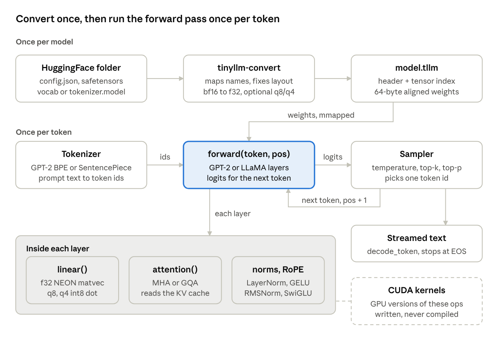

# tinyllm

tinyllm is a from-scratch LLM inference engine in C++17 with no ML-framework
dependencies. It converts HuggingFace checkpoints into its own mmap-friendly
`.tllm` format and runs GPT-2 small and LLaMA-family models (tested on
TinyLlama-1.1B-Chat) on the CPU, with f32, INT8 or INT4 weights. Prompt
processing and generation both go one token at a time through a pre-allocated
KV cache. Hand-written CUDA kernels for the main ops are in `cuda/`, but they
are off by default and have not been compiled yet (see [Status](#status)).

The long-term goal is a correct engine for GPT-2 small, then LLaMA-class
models, quantized on CPU and CUDA, benchmarked against llama.cpp. The first
milestone (M1) was the narrowest end-to-end slice: load GPT-2 small, tokenize a
prompt, run one forward pass, and diff the logits against the HuggingFace
reference within an fp32 tolerance of 1e-3.

## Features

- **Models:** GPT-2 (learned position embeddings, LayerNorm, GELU, tied LM
  head) and LLaMA (RMSNorm, RoPE with HF `rotate_half` pairing, SwiGLU,
  grouped-query attention, separate LM head).
- **Weights:** a converter reads `config.json` + `model.safetensors`
  (f32/f16/bf16) and writes one `.tllm` file. The loader mmaps it and hands out
  zero-copy, 64-byte-aligned tensor views.
- **Quantization:** optional Q8 or Q4 for the 2D linear weights, in blocks of
  32 with an fp32 scale per block. Quantized matvecs quantize the activation to
  int8 and use int8 dot products (NEON `sdot` where the CPU has it).
- **CPU kernels:** NEON f32 matvec with scalar fallbacks, a persistent thread
  pool, and MHA/GQA attention over the KV cache.
- **Tokenizers:** a hand-written GPT-2 byte-level BPE, and SentencePiece for
  LLaMA.
- **Sampling:** greedy, temperature, top-k and top-p, with a seedable RNG.
- **Memory:** each model allocates all activations and its KV cache up front
  from one arena, so the forward pass doesn't allocate activations per token.
- **CUDA (unbuilt):** tiled shared-memory GEMM, warp-per-row matvec, fused
  single-query GQA attention, layer norm and softmax, plus a benchmark that
  compares them with the CPU ops and cuBLAS.

## Build

Needs CMake 3.20+, a C++17 compiler and SentencePiece. Development has been on
an Apple Silicon Mac; the converter and loader use POSIX `mmap`, so Windows is
not supported.

```sh
brew install sentencepiece        # the only external dependency (pulls in abseil)
cmake -S . -B build -G Ninja
cmake --build build
```

This builds `build/tinyllm-convert` and `build/tinyllm-cli`. The default build
type is Release with `-O3 -march=native`, so the binaries are tuned for the
machine that built them.

On Linux, install SentencePiece and pkg-config from your package manager. The
CMake file asks pkg-config for both `sentencepiece` and `absl_status`, because
Homebrew's `sentencepiece.pc` doesn't list abseil.

## Get a model

Models go in `models/`, which is gitignored. With the HuggingFace CLI
(`pip install -U huggingface_hub`; older versions call the command
`huggingface-cli download`):

```sh
hf download openai-community/gpt2 \
  config.json model.safetensors vocab.json merges.txt --local-dir models/gpt2

hf download TinyLlama/TinyLlama-1.1B-Chat-v1.0 \
  config.json model.safetensors tokenizer.model --local-dir models/tinyllama
```

The converter reads a single `model.safetensors` file. Sharded checkpoints
(`model-00001-of-0000N.safetensors`) are not supported.

## Convert and run

```sh
# HF model dir -> .tllm
./build/tinyllm-convert models/gpt2 gpt2.tllm
./build/tinyllm-convert models/tinyllama tinyllama-q4.tllm --quant q4   # or --quant q8

# Greedy GPT-2
./build/tinyllm-cli -m gpt2.tllm -p "The capital of France is" -n 64 --temp 0

# TinyLlama with its chat template
./build/tinyllm-cli -m tinyllama-q4.tllm --chat -p "What is a KV cache?" -n 128
```

The CLI streams text to stdout and prints load time and prompt/generation
throughput to stderr. On an M-series Mac, GPT-2 f32 generates at about
190 tok/s and TinyLlama Q4 at about 87 tok/s. These are single informal runs,
not benchmarks.

### CLI options

| Flag | Default | Meaning |
| --- | --- | --- |
| `-m, --model PATH` | required | Converted `.tllm` model |
| `-p, --prompt TEXT` | required | Prompt text |
| `-t, --tokenizer PATH` | see below | GPT-2: directory with `vocab.json` + `merges.txt`. LLaMA: `tokenizer.model` |
| `-n, --n-predict N` | 128 | Maximum tokens to generate |
| `--temp F` | 0.8 | Temperature; `<= 0` is greedy |
| `--top-k N` | 40 | Top-k; `<= 0` disables |
| `--top-p F` | 0.95 | Nucleus p; `>= 1` disables |
| `--seed N` | 0 | RNG seed; 0 picks a random seed |
| `--ctx N` | 0 | Context length; 0 uses the model's (LLaMA capped at 2048). Never above the model's maximum |
| `--chat` | off | Wrap the prompt in the TinyLlama chat template (LLaMA only) |
| `-h, --help` | | Show usage |

The tokenizer defaults are `models/gpt2` for GPT-2 and
`models/tinyllama/tokenizer.model` for LLaMA. Tokenizers never add BOS; the CLI
prepends it for LLaMA models.

`TINYLLM_THREADS` sets the thread count for the f32 matvec and attention. It
defaults to the number of hardware threads. The Q8/Q4 matvec pool doesn't read
it yet and always uses the hardware thread count (at most 32).

## The .tllm format

One little-endian file, defined in
[`include/tinyllm/format.h`](include/tinyllm/format.h):

1. `FileHeader`: magic `TLLM`, version, tensor count, a POD `Config` (arch,
   dimensions, layer and head counts, context length, norm eps, RoPE theta,
   BOS/EOS ids), and the offsets of the index and the data.
2. A `TensorEntry` index: canonical name (64 bytes), dtype (F32/Q8/Q4), shape,
   offset, size.
3. Tensor data, 64-byte aligned, with each tensor's offset aligned too.

The converter maps HF names to canonical ones (`tok_emb`, `l{i}.attn.qkv.w`,
`l{i}.mlp.down.w`, ...), converts f16/bf16 to f32, and transposes GPT-2's
Conv1D weights, so every linear weight is stored `[out, in]`. With `--quant`,
only 2D linear weights are quantized; embeddings, norms and biases stay f32.
The Q4 nibble layout (low nibble is element j, high nibble is element j+16) is
shared by the converter and the kernels, so changing it breaks existing files.

## Architecture



- `tinyllm-convert` (`tools/convert.cpp`) runs once per model.
- `load_model()` (`src/model.cpp`) mmaps the `.tllm` file and builds a GPT-2
  (`src/gpt2.cpp`) or LLaMA (`src/llama.cpp`) model based on `Config::arch`.
- `Model::forward(token, pos)` runs one token, writes its K and V to the cache
  (`[layer][pos][kv_dim]`) and returns the logits. Positions must be fed in
  order.
- `linear()` (`include/tinyllm/ops.h`) is the single matvec entry point. It
  dispatches on dtype: f32 in `src/ops_cpu.cpp`, Q8/Q4 in `src/quant.cpp`.
  Each of those files has its own thread pool. The LLaMA ops are in
  `src/ops_llama.cpp`.
- The CUDA kernels cover matmul/matvec, attention, layer norm and softmax.
  There are no CUDA versions of RMSNorm, RoPE, SwiGLU, GELU or the quantized
  matvecs yet, and nothing in the CPU engine calls the CUDA code.

The headers in [`include/tinyllm/`](include/tinyllm/) are the contracts between
these pieces.

## Testing

```sh
ctest --test-dir build --output-on-failure
```

A GoogleTest suite is being added.

## Status

What has been checked, and how:

- **GPT-2 f32:** logits were compared once against an independent reference
  implementation that reads the safetensors file directly, and matched to
  within 6e-5. That was a one-off check; it is not yet a test in this repo.
- **TinyLlama (f32, Q8, Q4) and quantized GPT-2:** spot-checked only, by
  reading the generated text.
- **CUDA:** the kernels and the cuBLAS benchmark are written but have never
  been compiled, run or benchmarked. The development machine has no NVIDIA GPU.

Limitations:

- CPU only in practice. The NEON paths are tuned for Apple Silicon; other CPUs
  use plain scalar loops.
- One token per forward call, prefill included, so long prompts are slow.
- Single-file safetensors only; GPT-2 and LLaMA architectures only.
- No comparison against llama.cpp yet.

### Building the CUDA kernels

On a Linux machine with nvcc, cuBLAS and the SentencePiece dependency above:

```sh
cmake -S . -B build-cuda -G Ninja -DTINYLLM_CUDA=ON
cmake --build build-cuda
./build-cuda/cuda/tinyllm-bench-cuda
```

See [`cuda/README.md`](cuda/README.md) for kernel details. Expect this to need
fixes the first time it is built.

## License

MIT. See [LICENSE](LICENSE).
